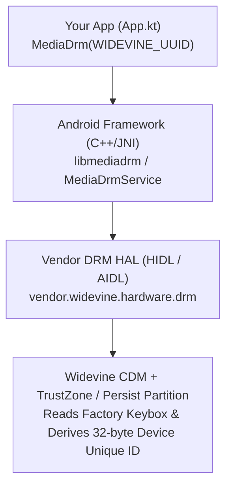
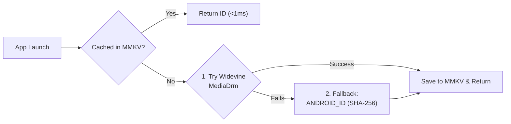

# Android Widevine & Persistent Device Unique ID Guide

This document explains how **Google Widevine DRM** works from the ground up on Android, why `MediaDrm.PROPERTY_DEVICE_UNIQUE_ID` survives app uninstallation/reinstallation, and how to implement a production-grade persistent Device ID strategy.

---

## 1. What is Widevine (From the Ground Up)?

### 1.1 Why Does Widevine Exist on Android?
**Widevine** is Google's Digital Rights Management (DRM) system built into Android so streaming applications (Netflix, YouTube, Spotify, etc.) can securely decrypt and play protected media.

To prove to a license server that a physical device is authentic, **every certified Android device is provisioned at the factory with a cryptographic DRM identity (Keybox / Device Certificate)**.

### 1.2 Architecture Under the Hood
When an Android app instantiates `MediaDrm(WIDEVINE_UUID)` and queries `PROPERTY_DEVICE_UNIQUE_ID`, the call traverses four layers of the Android stack:



1. **Application Layer (`android.media.MediaDrm`)**:
   - `MediaDrm.getPropertyByteArray(...)` is an instance method. Creating `MediaDrm(uuid)` requires the registered UUID of a DRM scheme plugin.
   - Widevine's official UUID is **`edef8ba9-79d6-4ace-a3c8-27dcd51d21ed`**.
2. **Android Native Framework (`libmediadrm`)**:
   - Communicates over Binder IPC with the system `mediadrmserver` / vendor DRM HAL service.
3. **Widevine CDM (Content Decryption Module)**:
   - **Widevine L1 (Hardware TEE)**: Cryptographic operations and keybox storage run inside the CPU's Trusted Execution Environment (e.g., ARM TrustZone / RPMB partition).
   - **Widevine L3 (Software CDM)**: Cryptographic operations run in a protected native library backed by factory-provisioned certificates in `/mnt/vendor/persist`.
4. **`PROPERTY_DEVICE_UNIQUE_ID` Derivation**:
   - Widevine takes the device's hardware/factory DRM identity and deterministically hashes it (on Android 8.0+ / Widevine v14+, it HMAC-hashes the hardware DRM key with the calling app's **APK signing certificate**).
   - Returns a **32-byte (256-bit) SHA-256 `ByteArray`**.

### 1.3 Why `private val WIDEVINE_UUID = UUID.fromString("edef8ba9-79d6-4ace-a3c8-27dcd51d21ed")`?

You may wonder why this specific hardcoded UUID string is required and why we must declare it manually:

1. **`MediaDrm` Uses a Modular Plugin Architecture**:
   - Android's `android.media.MediaDrm` class is **not** hardcoded to Google Widevine. It is a generic, vendor-neutral frontend that can talk to multiple DRM plugins installed on the device.
   - When you pass `WIDEVINE_UUID` to `MediaDrm.isCryptoSchemeSupported(WIDEVINE_UUID)` or `MediaDrm(WIDEVINE_UUID)`, the Android `MediaDrmService` queries every registered DRM HAL plugin on the device (`IDrmFactory::isCryptoSchemeSupported`) until the **Widevine CDM plugin** claims that 16-byte identifier.
2. **It Is an Official Global Standard Identifier (Not a Random UUID)**:
   - `edef8ba9-79d6-4ace-a3c8-27dcd51d21ed` was **not** randomly generated by an app developer.
   - It is the official **DRM System ID** permanently assigned to **Google Widevine** under the **ISO/IEC 23001-7 (Common Encryption / CENC)** specification and the **DASH Industry Forum (DASH-IF)** registry:

   | DRM Scheme | Official System ID (`UUID`) | Typical Android Support |
   | :--- | :--- | :--- |
   | **Google Widevine** | `edef8ba9-79d6-4ace-a3c8-27dcd51d21ed` | Built into ~99% of GMS-certified Android devices |
   | **W3C ClearKey** | `e2719d58-a985-b3c9-781a-b030af78d30e` | Built into AOSP (software test/cleartext scheme, no hardware ID) |
   | **Microsoft PlayReady** | `9a04f079-9840-4286-ab92-e65be0885f95` | Select Android TVs / set-top boxes |
   | **Huawei WisePlay** | `3d5e6d35-9b9a-41e8-b843-dd3c6e72c42c` | HMS / HarmonyOS devices |

3. **Why Android's Standard SDK Does Not Provide This Constant**:
   - Because `android.media.MediaDrm` in the core AOSP framework is designed to remain agnostic of proprietary DRM vendors, the Android SDK intentionally does **not** expose a `MediaDrm.WIDEVINE_UUID` constant.
   - Third-party media libraries like **AndroidX Media3 (ExoPlayer)** define it as `androidx.media3.common.C.WIDEVINE_UUID`.
   - Declaring `private val WIDEVINE_UUID = UUID.fromString("edef8ba9-79d6-4ace-a3c8-27dcd51d21ed")` inside the `companion object` avoids pulling in the entire Media3/ExoPlayer dependency just for one constant, and ensures the UUID string is parsed only once in memory.

### 1.4 Widevine Security Levels: L1 vs. L3

In Google Widevine, **L1 (Level 1)** and **L3 (Level 3)** define **where** the cryptographic keys and decrypted video frames are processed—either inside isolated **hardware** or in **software**.

| Feature | **Widevine L1 (Highest Security)** | **Widevine L3 (Basic Security)** |
| :--- | :--- | :--- |
| **Execution Environment** | **Hardware TEE** (Trusted Execution Environment, e.g., ARM TrustZone) — completely isolated from the Android OS | **Software CDM** (obfuscated C++ library in normal Android memory) |
| **Where Keys / Keybox Live** | Hardware-fused storage / RPMB partition (inaccessible even with `root`) | Protected vendor partition (`/mnt/vendor/persist`) |
| **Video Decryption & Rendering** | Decrypted & decoded inside a **secure hardware memory path** directly to the display controller (screenshots/screen recording show a black screen) | Decrypted in **standard system RAM** and passed to the standard decoder |
| **Streaming Resolution (Netflix, Prime, Disney+)** | **HD (1080p), 4K UHD, HDR** | **SD only (480p / 540p)** |
| **Typical Devices** | Mid-range & flagship phones | Entry-level/budget phones (like OPPO A12), or L1 phones whose **bootloader was unlocked** |

*(Note: **L2** also exists—where crypto happens in the hardware TEE, but video decoding happens in normal memory—however, Android phones almost exclusively use **L1** or **L3**).*

#### How Does L1 vs. L3 Affect `PROPERTY_DEVICE_UNIQUE_ID`?

1. **Both Return a Valid 32-Byte Persistent ID**:
   - Whether a device is **L1** or **L3** (e.g., OPPO A12 reporting `securityLevel=L3, systemId=4445`), `mediaDrm.getPropertyByteArray(MediaDrm.PROPERTY_DEVICE_UNIQUE_ID)` still returns a deterministic **32-byte SHA-256 ID** that survives app uninstallation, reinstallation, and factory resets.
2. **Tamper / Root Resistance**:
   - **On L1**: Even if an attacker roots the phone, they cannot read or spoof the raw Widevine Keybox because it never leaves the CPU's TrustZone.
   - **On L3**: It still survives normal factory resets and app reinstalls, though a root user who manually wipes `/mnt/vendor/persist` could corrupt the software keybox.
3. **Bootloader Unlocking**:
   - If a user unlocks the bootloader on an L1 phone, the hardware TEE revokes L1 access and falls back to the L3 software engine, which switches the `systemId` and produces a different `PROPERTY_DEVICE_UNIQUE_ID`. For normal users, the level remains fixed for the life of the device.

#### Why Do Devices Run in L3, and Does That Mean the Phone Is Unsecured?

Having **Widevine L3** does **not** mean the phone itself is insecure for personal data, banking apps, or everyday use:

1. **Android OS Security vs. DRM Security (Does L3 Mean Unsecured?)**:
   - **Android OS Security** (SELinux, app sandboxing, lockscreen encryption, and Android Keystore for banking/biometrics) protects **the phone owner** from malicious apps or hackers. An L3 phone still has full Android OS security.
   - **Widevine DRM** protects **content providers (Netflix, Disney+, Spotify)** from **the phone owner** trying to rip/pirate decrypted movies out of the phone's RAM.
   - On a **non-rooted L3 phone**, normal apps still **cannot** access Widevine's keys or video frames because Android's Linux kernel and SELinux block them. Movie studios only classify L3 as "Basic Security" because *if* someone roots an L3 phone, they could attach a memory debugger to RAM and capture the video stream (which is why Netflix/Disney+ cap L3 devices at **480p SD**).
2. **Why Manufacturers Ship Devices with Widevine L3**:
   - **Manufacturing & Certification Cost on Budget Phones (e.g., OPPO A12)**: While Google does not charge a license fee for Widevine, achieving **Widevine L1** requires the OEM to build a secure **factory provisioning assembly line** (injecting unique keys into each CPU's TrustZone/RPMB chip) and pass third-party hardware security audits for that specific model. For entry-level phones (which often only have 720p screens anyway), OEMs frequently skip L1 factory provisioning to keep manufacturing costs low and ship Google's standard **Widevine L3** instead.
   - **Universal Compatibility**: Entry-level chipsets, some Android TV boxes, automotive head units, and Android Emulators may lack a dedicated hardware Secure Video Path (SVP). **L3 acts as the universal baseline** so ~99% of certified Android devices can play DRM-protected audio/video out of the box.
   - **Bootloader Unlocking (Automatic Downgrade)**: When a user unlocks the bootloader on an L1 phone, the CPU's TrustZone detects that the verified boot chain is broken and locks out the L1 hardware keys, automatically downgrading the device to **L3**.

---

## 2. Why Does Widevine ID Survive App Uninstall & Reinstall?

When a user **uninstalls** your app:
- Android deletes `/data/data/<package_name>` (clearing `MMKV`, `SharedPreferences`, `DataStore`, Room databases, and internal files) and resets runtime permissions.
- **However**, Widevine's DRM Keybox lives in the **hardware TEE / vendor persist partition**, completely outside your app's sandbox.

When the user **reinstalls** your app (signed with the same keystore):
- Widevine executes the exact same deterministic derivation:
  $$\text{Widevine ID} = \text{HMAC-SHA256}(\text{Device Hardware DRM Key}, \text{App Signing Certificate})$$
- **Result**: You receive the **exact same 32-byte ID** every time, with **zero runtime permissions** required.

---

## 3. Comparing All Android Device ID Methods (Android 8 – 16+)

Starting in Android 10 (API 29), third-party apps can no longer access `IMEI`, `MEID`, `Serial Number`, or hardware `MAC Address` (`SecurityException`). Below is how modern identifier mechanisms compare:

| Method | Needs Permission? | Survives App Reinstall? | Survives Factory Reset? | Device Coverage |
| :--- | :---: | :---: | :---: | :---: |
| **1. Widevine ID (`MediaDrm`)** | No | **Yes** | **Yes** (usually) | ~99% of certified Android devices (may fail on custom AOSP ROMs or stripped emulators) |
| **2. `Settings.Secure.ANDROID_ID`** | No | **Yes** (Android 8.0+) | No | **100%** of Android devices |
| **3. Advertising ID (`GAID` / `OAID`)** | No | Yes (until user resets) | No | User can reset or opt out (zeros out ID) |

### Note on `Settings.Secure.ANDROID_ID` (Android 8.0+)
Since **Android 8.0 (API 26)**, `ANDROID_ID` (SSAID) is scoped to `(Device + User Profile + App Signing Key)`:
- Uninstalling and reinstalling the app (with the same signing key) returns the **exact same `ANDROID_ID`**.
- It only changes if the user performs a **Full Factory Reset**.

---

## 4. Production Best Practice (Defense-in-Depth Strategy)

Because `MediaDrm` makes a native Binder/HAL call (~50–150 ms) and ~1% of uncertified devices/emulators may not support Widevine, production apps should combine **local caching (`MMKV`)** with **`Settings.Secure.ANDROID_ID` as the fallback**:



1. **Fast Local Cache (`MMKV`)**: Read the cached ID in `<1 ms` on subsequent launches. If the user uninstalls and reinstalls the app, `MMKV` is wiped and the app simply re-derives the exact same ID from Widevine / `ANDROID_ID`.
2. **Primary Source — Widevine `PROPERTY_DEVICE_UNIQUE_ID`**: Persists across app reinstalls and factory resets.
3. **Fallback — `Settings.Secure.ANDROID_ID`**: Hashed with SHA-256 to match the 64-character hex format; persists across app reinstalls on 100% of Android 8.0+ devices (no random `UUID` fallback is needed because `ANDROID_ID` is guaranteed by the OS, whereas a random `UUID` would generate a new identity on every reinstall).

---

## 5. Reference Implementation in `App.kt`

```kotlin
private val WIDEVINE_UUID = UUID.fromString("edef8ba9-79d6-4ace-a3c8-27dcd51d21ed")

private fun logDeviceUniqueId() {
    var mediaDrm: MediaDrm? = null
    try {
        if (!MediaDrm.isCryptoSchemeSupported(WIDEVINE_UUID)) {
            Timber.tag(TAG_MEDIA_DRM).w("Widevine DRM scheme is not supported on this device")
            return
        }
        mediaDrm = MediaDrm(WIDEVINE_UUID)
        val uniqueIdBytes = mediaDrm.getPropertyByteArray(MediaDrm.PROPERTY_DEVICE_UNIQUE_ID)
        val hexString = uniqueIdBytes.joinToString("") { "%02x".format(it) }
        val base64String = Base64.encodeToString(uniqueIdBytes, Base64.NO_WRAP)
        Timber.tag(TAG_MEDIA_DRM).d(
            "PROPERTY_DEVICE_UNIQUE_ID (size=%d): hex=%s, base64=%s",
            uniqueIdBytes.size,
            hexString,
            base64String
        )
    } catch (e: Exception) {
        Timber.tag(TAG_MEDIA_DRM).e(e, "Failed to retrieve PROPERTY_DEVICE_UNIQUE_ID")
    } finally {
        if (Build.VERSION.SDK_INT >= Build.VERSION_CODES.P) {
            mediaDrm?.close()
        } else {
            @Suppress("DEPRECATION")
            mediaDrm?.release()
        }
    }
}

@SuppressLint("HardwareIds")
private fun logAndroidId() {
    try {
        val androidId = Settings.Secure.getString(contentResolver, Settings.Secure.ANDROID_ID)
        if (androidId.isNullOrBlank()) {
            Timber.tag(TAG_ANDROID_ID).w("Settings.Secure.ANDROID_ID is null or blank")
            return
        }
        val sha256Bytes = MessageDigest.getInstance("SHA-256")
            .digest(androidId.toByteArray(Charsets.UTF_8))
        val sha256Hex = sha256Bytes.joinToString("") { "%02x".format(it) }
        val sha256Base64 = Base64.encodeToString(sha256Bytes, Base64.NO_WRAP)
        Timber.tag(TAG_ANDROID_ID).d(
            "ANDROID_ID: raw=%s, sha256Hex=%s, sha256Base64=%s",
            androidId,
            sha256Hex,
            sha256Base64
        )
    } catch (e: Exception) {
        Timber.tag(TAG_ANDROID_ID).e(e, "Failed to retrieve ANDROID_ID")
    }
}
```

---

## 6. Multi-Device Uninstall & Reinstall Verification Report (Android 9 – 17)

Every connected device below was tested by:
1. Installing `app-debug.apk` and capturing `MediaDrm`, `AndroidId`, and `DeviceCompat` logs (**Run 1 — Before Uninstall**).
2. Running `adb -s <device> uninstall com.genesys.codebase` to completely wipe the app and its sandbox (`/data/data/com.genesys.codebase`).
3. Reinstalling `app-debug.apk`, launching the app in a fresh process, and capturing logs (**Run 2 — After Reinstall**).

### 6.1 Summary Table

| # | Device / Serial | Brand & Market Name | Android / Custom OS | Widevine Security & System ID | Widevine `PROPERTY_DEVICE_UNIQUE_ID` (Hex) | `ANDROID_ID` (Raw -> SHA-256 Hex) | Survives Uninstall & Reinstall? |
| :- | :--- | :--- | :--- | :--- | :--- | :--- | :---: |
| **1** | `JFHQIRYSLRIRKJS8` | **OPPO** — OPPO A12 (`CPH2083`) | Android 9 (SDK 28)<br/>ColorOS `6.1.2` | **L3** (v14.0.0)<br/>`systemId=4445` | `b2812783f27acdf52cf153d85ee73044f749ba40750d70d2f84f7d7a143aff6e` | `806f9ed566e4a162`<br/>`8921331b72a3b0c62d22cb70861c70070965d6d0c2b7149af7d5956ad3497d1e` | **Yes** (PID `23117` -> `25797`) |
| **2** | `R58RB1XWAKJ` | **Samsung** — Samsung Galaxy A12 (`SM-A127F`) | Android 13 (SDK 33)<br/>OneUI `5.1` | **L1** (v16.1.0)<br/>`systemId=22909` | `ae5cd49a0a50bdc22046e736c7988e6a3072041f555421d467575f589c3a533f` | `441c0f886d3b92b9`<br/>`7358602f0c6747d85bd1d5420cca4e5a5ce80cbd96f38316461edf419791e4eb` | **Yes** (PID `27009` -> `27578`) |
| **3** | `adb-33081JEHN03270-88MehP._adb-tls-connect._tcp` | **Google** — Pixel 7a (`lynx`) | Android 17 (SDK 37)<br/>Stock AOSP | **L1** (v20.0.0)<br/>`systemId=27031` | `089b34ff13bdda03be4cd8cafa2bdcb8b2d7aa154c662d2bc995953aa12f2c3e` | `ece4a00b4f1bb027`<br/>`0da46c57a9d273c9af601fee545fc058ae82464593d3e202e6c381f82362b60f` | **Yes** (PID `6190` -> `6910`) |
| **4** | `adb-468QBFFT22325-zb5fSD._adb-tls-connect._tcp` | **MEIZU** — MEIZU 21 Note | Android 16 (SDK 36)<br/>Flyme `12.6.0.0` | **L1** (v17.0.1)<br/>`systemId=32163` | `6320e1e60a03c3cfba2c37dded3e1f0ed6968a1e35f1d37172bad12dcc9f3f33` | `1cb94bd3d918a1c2`<br/>`0d8b94dd71f57bf0cdd0324186090e8ac7bd4aeb85a03691ad2411cd26d685e4` | **Yes** (PID `14449` -> `15068`) |
| **5** | `adb-e8433565-xHeNgS._adb-tls-connect._tcp` | **Redmi** — Redmi Note 11 (`2201117TG`) | Android 13 (SDK 33)<br/>HyperOS `1.0.8.0` | **L1** (v16.0.1)<br/>`systemId=24133` | `572fe342fe9e32b896a09c30df42ff1b4786b6712d63e40fbc16f078978c7de3` | `3a8b82b96397a32a`<br/>`a4b05bb04825baa8c36399dd897a6f452246479c5fcde182679babe35aa947c1` | **Yes** (PID `11173` -> `16548`) |
| **6** | `emulator-5554` | **Google** — Emulator (`sdk_gphone64_x86_64`) | Android 17 (SDK 37)<br/>Emulator Image | **L3** (v20.0.0)<br/>`systemId=34954` | `ce93c25655ffa9b0af2e881e7fc9f9ff4a88e8cfbd074f8e74424d16cce7423c` | `2e40800caae4336c`<br/>`2f45f787ef76aa2bfa818968dadd29a2c71bc375c0039af55acd676723b9433b` | **Yes** (PID `6288` -> `7060`) |

### 6.2 Raw Logcat Output per Device (Before Uninstall vs. After Reinstall)

#### 1. OPPO A12 (`JFHQIRYSLRIRKJS8` — Android 9 / SDK 28)
```text
# Run 1 — Before Uninstall (PID 23117)
10-31 07:49:54.382 23117 23117 D MediaDrm    : PROPERTY_DEVICE_UNIQUE_ID (size=32): hex=b2812783f27acdf52cf153d85ee73044f749ba40750d70d2f84f7d7a143aff6e, base64=soEng/J6zfUs8VPYXucwRPdJukB1DXDS+E99ehQ6/24=
10-31 07:49:54.495 23117 23117 D MediaDrm    : MediaDrm Properties -> vendor=Google, version=14.0.0, description=Widevine CDM, algorithms=AES/CBC/NoPadding,HmacSHA256, securityLevel=L3, systemId=4445
10-31 07:49:54.551 23117 23117 D AndroidId   : ANDROID_ID: raw=806f9ed566e4a162, sha256Hex=8921331b72a3b0c62d22cb70861c70070965d6d0c2b7149af7d5956ad3497d1e, sha256Base64=iSEzG3KjsMYtIstwhhxwBwll1tDCtxSa99WVatNJfR4=
10-31 07:49:54.740 23117 23117 D DeviceCompat: DeviceCompat Info -> Brand: OPPO, MarketName: OPPO A12, OS: ColorOS (version=6.1.2, bigCode=6)

# Run 2 — After adb uninstall & reinstall (PID 25797)
10-31 07:59:17.306 25797 25797 D MediaDrm    : PROPERTY_DEVICE_UNIQUE_ID (size=32): hex=b2812783f27acdf52cf153d85ee73044f749ba40750d70d2f84f7d7a143aff6e, base64=soEng/J6zfUs8VPYXucwRPdJukB1DXDS+E99ehQ6/24=
10-31 07:59:17.404 25797 25797 D MediaDrm    : MediaDrm Properties -> vendor=Google, version=14.0.0, description=Widevine CDM, algorithms=AES/CBC/NoPadding,HmacSHA256, securityLevel=L3, systemId=4445
10-31 07:59:17.452 25797 25797 D AndroidId   : ANDROID_ID: raw=806f9ed566e4a162, sha256Hex=8921331b72a3b0c62d22cb70861c70070965d6d0c2b7149af7d5956ad3497d1e, sha256Base64=iSEzG3KjsMYtIstwhhxwBwll1tDCtxSa99WVatNJfR4=
10-31 07:59:17.584 25797 25797 D DeviceCompat: DeviceCompat Info -> Brand: OPPO, MarketName: OPPO A12, OS: ColorOS (version=6.1.2, bigCode=6)
```

#### 2. Samsung Galaxy A12 (`R58RB1XWAKJ` — Android 13 / SDK 33)
```text
# Run 1 — Before Uninstall (PID 27009)
10-31 07:48:45.055 27009 27009 D MediaDrm    : PROPERTY_DEVICE_UNIQUE_ID (size=32): hex=ae5cd49a0a50bdc22046e736c7988e6a3072041f555421d467575f589c3a533f, base64=rlzUmgpQvcIgRuc2x5iOajByBB9VVCHUZ1dfWJw6Uz8=
10-31 07:48:45.059 27009 27009 D MediaDrm    : MediaDrm Properties -> vendor=Google, version=16.1.0, description=Widevine CDM, algorithms=AES/CBC/NoPadding,HmacSHA256, securityLevel=L1, systemId=22909
10-31 07:48:45.087 27009 27009 D AndroidId   : ANDROID_ID: raw=441c0f886d3b92b9, sha256Hex=7358602f0c6747d85bd1d5420cca4e5a5ce80cbd96f38316461edf419791e4eb, sha256Base64=c1hgLwxnR9hb0dVCDMpOWlzoDL2W84MWRh7fQZeR5Os=
10-31 07:48:45.342 27009 27009 D DeviceCompat: DeviceCompat Info -> Brand: Samsung, MarketName: Samsung Galaxy A12, OS: OneUI (version=5.1, bigCode=5)

# Run 2 — After adb uninstall & reinstall (PID 27578)
10-31 07:59:23.069 27578 27578 D MediaDrm    : PROPERTY_DEVICE_UNIQUE_ID (size=32): hex=ae5cd49a0a50bdc22046e736c7988e6a3072041f555421d467575f589c3a533f, base64=rlzUmgpQvcIgRuc2x5iOajByBB9VVCHUZ1dfWJw6Uz8=
10-31 07:59:23.074 27578 27578 D MediaDrm    : MediaDrm Properties -> vendor=Google, version=16.1.0, description=Widevine CDM, algorithms=AES/CBC/NoPadding,HmacSHA256, securityLevel=L1, systemId=22909
10-31 07:59:23.106 27578 27578 D AndroidId   : ANDROID_ID: raw=441c0f886d3b92b9, sha256Hex=7358602f0c6747d85bd1d5420cca4e5a5ce80cbd96f38316461edf419791e4eb, sha256Base64=c1hgLwxnR9hb0dVCDMpOWlzoDL2W84MWRh7fQZeR5Os=
10-31 07:59:23.375 27578 27578 D DeviceCompat: DeviceCompat Info -> Brand: Samsung, MarketName: Samsung Galaxy A12, OS: OneUI (version=5.1, bigCode=5)
```

#### 3. Google Pixel 7a (`adb-33081JEHN03270-88MehP._adb-tls-connect._tcp` — Android 17 / SDK 37)
```text
# Run 1 — Before Uninstall (PID 6190)
10-31 07:48:50.651  6190  6190 D MediaDrm    : PROPERTY_DEVICE_UNIQUE_ID (size=32): hex=089b34ff13bdda03be4cd8cafa2bdcb8b2d7aa154c662d2bc995953aa12f2c3e, base64=CJs0/xO92gO+TNjK+ivcuLLXqhVMZi0ryZWVOqEvLD4=
10-31 07:48:50.671  6190  6190 D MediaDrm    : MediaDrm Properties -> vendor=com.google.android.widevine, version=20.0.0@ZV1R.260313.001, description=Widevine CDM, algorithms=AES/CBC/NoPadding,HmacSHA256, securityLevel=L1, systemId=27031
10-31 07:48:50.680  6190  6190 D AndroidId   : ANDROID_ID: raw=ece4a00b4f1bb027, sha256Hex=0da46c57a9d273c9af601fee545fc058ae82464593d3e202e6c381f82362b60f, sha256Base64=DaRsV6nSc8mvYB/uVF/AWK6CRkWT0+IC5sOB+CNitg8=
10-31 07:48:50.896  6190  6190 D DeviceCompat: DeviceCompat Info -> Brand: Google, MarketName: Pixel 7a, OS:  (version=, bigCode=-1)

# Run 2 — After adb uninstall & reinstall (PID 6910)
10-31 07:59:29.423  6910  6910 D MediaDrm    : PROPERTY_DEVICE_UNIQUE_ID (size=32): hex=089b34ff13bdda03be4cd8cafa2bdcb8b2d7aa154c662d2bc995953aa12f2c3e, base64=CJs0/xO92gO+TNjK+ivcuLLXqhVMZi0ryZWVOqEvLD4=
10-31 07:59:29.434  6910  6910 D MediaDrm    : MediaDrm Properties -> vendor=com.google.android.widevine, version=20.0.0@ZV1R.260313.001, description=Widevine CDM, algorithms=AES/CBC/NoPadding,HmacSHA256, securityLevel=L1, systemId=27031
10-31 07:59:29.441  6910  6910 D AndroidId   : ANDROID_ID: raw=ece4a00b4f1bb027, sha256Hex=0da46c57a9d273c9af601fee545fc058ae82464593d3e202e6c381f82362b60f, sha256Base64=DaRsV6nSc8mvYB/uVF/AWK6CRkWT0+IC5sOB+CNitg8=
10-31 07:59:29.660  6910  6910 D DeviceCompat: DeviceCompat Info -> Brand: Google, MarketName: Pixel 7a, OS:  (version=, bigCode=-1)
```

#### 4. MEIZU 21 Note (`adb-468QBFFT22325-zb5fSD._adb-tls-connect._tcp` — Android 16 / SDK 36)
```text
# Run 1 — Before Uninstall (PID 14449)
10-31 07:49:57.675 14449 14449 D MediaDrm    : PROPERTY_DEVICE_UNIQUE_ID (size=32): hex=6320e1e60a03c3cfba2c37dded3e1f0ed6968a1e35f1d37172bad12dcc9f3f33, base64=YyDh5goDw8+6LDfd7T4fDtaWih418dNxcrrRLcyfPzM=
10-31 07:49:57.676 14449 14449 D MediaDrm    : MediaDrm Properties -> vendor=Google, version=17.0.1@004, description=Widevine CDM, algorithms=AES/CBC/NoPadding,HmacSHA256, securityLevel=L1, systemId=32163
10-31 07:49:57.681 14449 14449 D AndroidId   : ANDROID_ID: raw=1cb94bd3d918a1c2, sha256Hex=0d8b94dd71f57bf0cdd0324186090e8ac7bd4aeb85a03691ad2411cd26d685e4, sha256Base64=DYuU3XH1e/DN0DJBhgkOise9SuuFoDaRrSQRzSbWheQ=
10-31 07:49:57.765 14449 14449 D DeviceCompat: DeviceCompat Info -> Brand: MEIZU, MarketName: MEIZU 21 Note, OS: Flyme (version=12.6.0.0, bigCode=12)

# Run 2 — After adb uninstall & reinstall (PID 15068)
10-31 07:59:36.454 15068 15068 D MediaDrm    : PROPERTY_DEVICE_UNIQUE_ID (size=32): hex=6320e1e60a03c3cfba2c37dded3e1f0ed6968a1e35f1d37172bad12dcc9f3f33, base64=YyDh5goDw8+6LDfd7T4fDtaWih418dNxcrrRLcyfPzM=
10-31 07:59:36.455 15068 15068 D MediaDrm    : MediaDrm Properties -> vendor=Google, version=17.0.1@004, description=Widevine CDM, algorithms=AES/CBC/NoPadding,HmacSHA256, securityLevel=L1, systemId=32163
10-31 07:59:36.461 15068 15068 D AndroidId   : ANDROID_ID: raw=1cb94bd3d918a1c2, sha256Hex=0d8b94dd71f57bf0cdd0324186090e8ac7bd4aeb85a03691ad2411cd26d685e4, sha256Base64=DYuU3XH1e/DN0DJBhgkOise9SuuFoDaRrSQRzSbWheQ=
10-31 07:59:36.547 15068 15068 D DeviceCompat: DeviceCompat Info -> Brand: MEIZU, MarketName: MEIZU 21 Note, OS: Flyme (version=12.6.0.0, bigCode=12)
```

#### 5. Xiaomi Redmi Note 11 (`adb-e8433565-xHeNgS._adb-tls-connect._tcp` — Android 13 / SDK 33)
```text
# Run 1 — Before Uninstall (PID 11173)
10-31 07:49:12.401 11173 11173 D MediaDrm    : PROPERTY_DEVICE_UNIQUE_ID (size=32): hex=572fe342fe9e32b896a09c30df42ff1b4786b6712d63e40fbc16f078978c7de3, base64=Vy/jQv6eMriWoJww30L/G0eGtnEtY+QPvBbweJeMfeM=
10-31 07:49:12.407 11173 11173 D MediaDrm    : MediaDrm Properties -> vendor=Google, version=16.0.1@003, description=Widevine CDM, algorithms=AES/CBC/NoPadding,HmacSHA256, securityLevel=L1, systemId=24133
10-31 07:49:12.438 11173 11173 D AndroidId   : ANDROID_ID: raw=3a8b82b96397a32a, sha256Hex=a4b05bb04825baa8c36399dd897a6f452246479c5fcde182679babe35aa947c1, sha256Base64=pLBbsEgluqjDY5ndiXpvRSJGR5xfzeGCZ5ur41qpR8E=
10-31 07:49:12.442 11173 11173 D DeviceCompat: DeviceCompat Info -> Brand: Redmi, MarketName: Redmi Note 11, OS: HyperOS (version=1.0.8.0, bigCode=1)

# Run 2 — After adb uninstall & reinstall (PID 16548)
10-31 08:00:29.148 16548 16548 D MediaDrm    : PROPERTY_DEVICE_UNIQUE_ID (size=32): hex=572fe342fe9e32b896a09c30df42ff1b4786b6712d63e40fbc16f078978c7de3, base64=Vy/jQv6eMriWoJww30L/G0eGtnEtY+QPvBbweJeMfeM=
10-31 08:00:29.156 16548 16548 D MediaDrm    : MediaDrm Properties -> vendor=Google, version=16.0.1@003, description=Widevine CDM, algorithms=AES/CBC/NoPadding,HmacSHA256, securityLevel=L1, systemId=24133
10-31 08:00:29.188 16548 16548 D AndroidId   : ANDROID_ID: raw=3a8b82b96397a32a, sha256Hex=a4b05bb04825baa8c36399dd897a6f452246479c5fcde182679babe35aa947c1, sha256Base64=pLBbsEgluqjDY5ndiXpvRSJGR5xfzeGCZ5ur41qpR8E=
10-31 08:00:29.195 16548 16548 D DeviceCompat: DeviceCompat Info -> Brand: Redmi, MarketName: Redmi Note 11, OS: HyperOS (version=1.0.8.0, bigCode=1)
```

#### 6. Android Emulator (`emulator-5554` — `sdk_gphone64_x86_64` — Android 17 / SDK 37)
```text
# Run 1 — Before Uninstall (PID 6288)
10-31 07:49:12.746  6288  6288 D MediaDrm    : PROPERTY_DEVICE_UNIQUE_ID (size=32): hex=ce93c25655ffa9b0af2e881e7fc9f9ff4a88e8cfbd074f8e74424d16cce7423c, base64=zpPCVlX/qbCvLogef8n5/0qI6M+9B0+OdEJNFsznQjw=
10-31 07:49:12.747  6288  6288 D MediaDrm    : MediaDrm Properties -> vendor=com.google.android.widevine, version=20.0.0@ZV1R.260313.001, description=Widevine CDM, algorithms=AES/CBC/NoPadding,HmacSHA256, securityLevel=L3, systemId=34954
10-31 07:49:12.750  6288  6288 D AndroidId   : ANDROID_ID: raw=2e40800caae4336c, sha256Hex=2f45f787ef76aa2bfa818968dadd29a2c71bc375c0039af55acd676723b9433b, sha256Base64=L0X3h+92qiv6gYlo2t0poscbw3XAA5r1Ws1nZyO5Qzs=
10-31 07:49:12.875  6288  6288 D DeviceCompat: DeviceCompat Info -> Brand: Google, MarketName: , OS:  (version=, bigCode=-1)

# Run 2 — After adb uninstall & reinstall (PID 7060)
10-31 07:59:46.813  7060  7060 D MediaDrm    : PROPERTY_DEVICE_UNIQUE_ID (size=32): hex=ce93c25655ffa9b0af2e881e7fc9f9ff4a88e8cfbd074f8e74424d16cce7423c, base64=zpPCVlX/qbCvLogef8n5/0qI6M+9B0+OdEJNFsznQjw=
10-31 07:59:46.814  7060  7060 D MediaDrm    : MediaDrm Properties -> vendor=com.google.android.widevine, version=20.0.0@ZV1R.260313.001, description=Widevine CDM, algorithms=AES/CBC/NoPadding,HmacSHA256, securityLevel=L3, systemId=34954
10-31 07:59:46.817  7060  7060 D AndroidId   : ANDROID_ID: raw=2e40800caae4336c, sha256Hex=2f45f787ef76aa2bfa818968dadd29a2c71bc375c0039af55acd676723b9433b, sha256Base64=L0X3h+92qiv6gYlo2t0poscbw3XAA5r1Ws1nZyO5Qzs=
10-31 07:59:46.930  7060  7060 D DeviceCompat: DeviceCompat Info -> Brand: Google, MarketName: , OS:  (version=, bigCode=-1)
```
