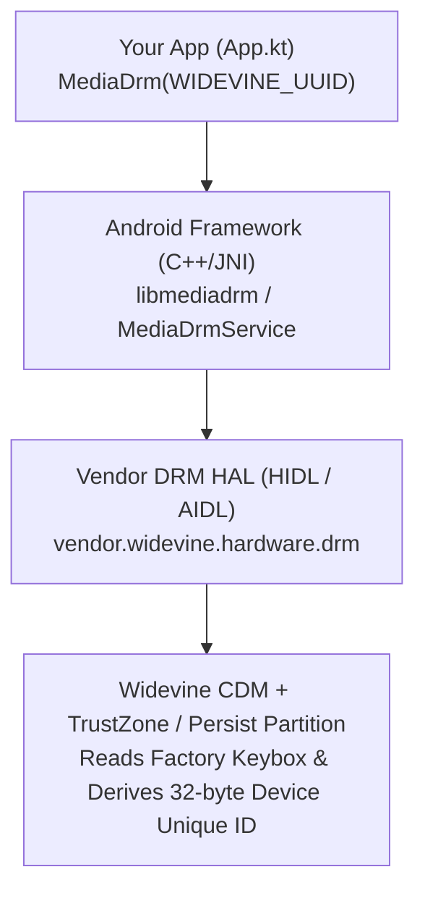
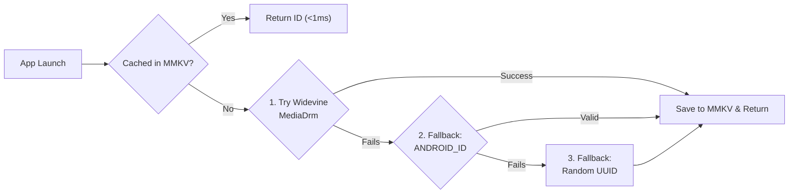

# Android Widevine & Persistent Device Unique ID Guide

This document explains how **Google Widevine DRM** works from the ground up on Android, why `MediaDrm.PROPERTY_DEVICE_UNIQUE_ID` survives app uninstallation/reinstallation, how it differs from OS system properties (`DeviceCompat`), and how to implement a production-grade persistent Device ID strategy.

---

## 1. What is Widevine (From the Ground Up)?

### 1.1 Why Does Widevine Exist on Android?
**Widevine** is Google's Digital Rights Management (DRM) system built into Android so streaming applications (Netflix, YouTube, Spotify, etc.) can securely decrypt and play protected media.

To prove to a license server that a physical device is authentic, **every certified Android device is provisioned at the factory with a cryptographic DRM identity (Keybox / Device Certificate)**.

### 1.2 Architecture Under the Hood
When an Android app instantiates `MediaDrm(WIDEVINE_UUID)` and queries `PROPERTY_DEVICE_UNIQUE_ID`, the call traverses four layers of the Android stack:



1. **Application Layer (`android.media.MediaDrm`)**:
   - `MediaDrm.getPropertyByteArray(...)` is an instance method. Creating `MediaDrm(uuid)` requires the registered UUID of a DRM scheme plugin.
   - Widevine's official UUID is **`edef8ba9-79d6-4ace-a3c8-27dcd51d21ed`**.
2. **Android Native Framework (`libmediadrm`)**:
   - Communicates over Binder IPC with the system `mediadrmserver` / vendor DRM HAL service.
3. **Widevine CDM (Content Decryption Module)**:
   - **Widevine L1 (Hardware TEE)**: Cryptographic operations and keybox storage run inside the CPU's Trusted Execution Environment (e.g., ARM TrustZone / RPMB partition).
   - **Widevine L3 (Software CDM)**: Cryptographic operations run in a protected native library backed by factory-provisioned certificates in `/mnt/vendor/persist`.
4. **`PROPERTY_DEVICE_UNIQUE_ID` Derivation**:
   - Widevine takes the device's hardware/factory DRM identity and deterministically hashes it (on Android 8.0+ / Widevine v14+, it HMAC-hashes the hardware DRM key with the calling app's **APK signing certificate**).
   - Returns a **32-byte (256-bit) SHA-256 `ByteArray`**.

---

## 2. Why Does Widevine ID Survive App Uninstall & Reinstall?

When a user **uninstalls** your app:
- Android deletes `/data/data/<package_name>` (clearing `MMKV`, `SharedPreferences`, `DataStore`, Room databases, and internal files) and resets runtime permissions.
- **However**, Widevine's DRM Keybox lives in the **hardware TEE / vendor persist partition**, completely outside your app's sandbox.

When the user **reinstalls** your app (signed with the same keystore):
- Widevine executes the exact same deterministic derivation:
  $$\text{Widevine ID} = \text{HMAC-SHA256}(\text{Device Hardware DRM Key}, \text{App Signing Certificate})$$
- **Result**: You receive the **exact same 32-byte ID** every time, with **zero runtime permissions** required.

---

## 3. Comparing All Android Device ID Methods (Android 8 – 16+)

Starting in Android 10 (API 29), third-party apps can no longer access `IMEI`, `MEID`, `Serial Number`, or hardware `MAC Address` (`SecurityException`). Below is how modern identifier mechanisms compare:

| Method | Needs Permission? | Survives App Reinstall? | Survives Factory Reset? | Device Coverage |
| :--- | :---: | :---: | :---: | :---: |
| **1. Widevine ID (`MediaDrm`)** | No | **Yes** | **Yes** (usually) | ~99% of certified Android devices (may fail on custom AOSP ROMs or stripped emulators) |
| **2. `Settings.Secure.ANDROID_ID`** | No | **Yes** (Android 8.0+) | No | **100%** of Android devices |
| **3. Advertising ID (`GAID` / `OAID`)** | No | Yes (until user resets) | No | User can reset or opt out (zeros out ID) |
| **4. Random UUID in `MMKV`** | No | No | No | **100%** |

### Note on `Settings.Secure.ANDROID_ID` (Android 8.0+)
Since **Android 8.0 (API 26)**, `ANDROID_ID` (SSAID) is scoped to `(Device + User Profile + App Signing Key)`:
- Uninstalling and reinstalling the app (with the same signing key) returns the **exact same `ANDROID_ID`**.
- It only changes if the user performs a **Full Factory Reset**.

---

## 4. Production Best Practice (Defense-in-Depth Strategy)

Because `MediaDrm` makes a native Binder/HAL call (~50–150 ms) and ~1% of uncertified devices/emulators may not support Widevine, production apps should combine **local caching (`MMKV`)** with a **fallback chain**:



1. **Fast Local Cache (`MMKV`)**: Read the cached ID in `<1 ms` on subsequent launches. If the user uninstalls and reinstalls the app, `MMKV` is wiped and the app simply re-derives the exact same ID from Widevine / `ANDROID_ID`.
2. **Primary Source — Widevine `PROPERTY_DEVICE_UNIQUE_ID`**: Persists across app reinstalls and factory resets.
3. **Fallback 1 — `Settings.Secure.ANDROID_ID`**: Hashed with SHA-256 to match the 64-character hex format; persists across app reinstalls on 100% of Android 8.0+ devices.
4. **Fallback 2 — `UUID.randomUUID()`**: Final safety net persisted in `MMKV`.

---

## 5. `MediaDrm` vs `DeviceCompat` (`SystemPropertyCompat`)

| Feature | `android.media.MediaDrm` | `com.github.getActivity:DeviceCompat` |
| :--- | :--- | :--- |
| **Primary Purpose** | Queries the native DRM HAL / Widevine CDM plugin | Identifies Brand (`DeviceBrand`), Commercial Model (`DeviceMarketName`), Custom ROM (`DeviceOs`), and OS `getprop` properties (`SystemPropertyCompat`) |
| **Data Source** | Native DRM HAL / TrustZone / `/mnt/vendor/persist` | Android OS `SystemProperties` (`getprop` / `/system/build.prop`) |
| **Can Read `deviceUniqueId`?** | **Yes** (`getPropertyByteArray(PROPERTY_DEVICE_UNIQUE_ID)`) | **No** (`deviceUniqueId` is not stored in `getprop` or `build.prop`) |

### Sample Output (OPPO A12 / ColorOS 6.1.2)
```text
D/MediaDrm: PROPERTY_DEVICE_UNIQUE_ID (size=32): hex=b2812783f27acdf52cf153d85ee73044f749ba40750d70d2f84f7d7a143aff6e, base64=soEng/J6zfUs8VPYXucwRPdJukB1DXDS+E99ehQ6/24=
D/MediaDrm: MediaDrm Properties -> vendor=Google, version=14.0.0, description=Widevine CDM, algorithms=AES/CBC/NoPadding,HmacSHA256, securityLevel=L3, systemId=4445
D/DeviceCompat: DeviceCompat Info -> Brand: OPPO, MarketName: OPPO A12, OS: ColorOS (version=6.1.2, bigCode=6)
```

---

## 6. Reference Implementation in `App.kt`

```kotlin
private val WIDEVINE_UUID = UUID.fromString("edef8ba9-79d6-4ace-a3c8-27dcd51d21ed")

private fun logDeviceUniqueId() {
    var mediaDrm: MediaDrm? = null
    try {
        if (!MediaDrm.isCryptoSchemeSupported(WIDEVINE_UUID)) {
            Timber.tag("MediaDrm").w("Widevine DRM scheme is not supported on this device")
            return
        }
        mediaDrm = MediaDrm(WIDEVINE_UUID)
        val uniqueIdBytes = mediaDrm.getPropertyByteArray(MediaDrm.PROPERTY_DEVICE_UNIQUE_ID)
        val hexString = uniqueIdBytes.joinToString("") { "%02x".format(it) }
        val base64String = Base64.encodeToString(uniqueIdBytes, Base64.NO_WRAP)
        Timber.tag("MediaDrm").d(
            "PROPERTY_DEVICE_UNIQUE_ID (size=%d): hex=%s, base64=%s",
            uniqueIdBytes.size,
            hexString,
            base64String
        )
    } catch (e: Exception) {
        Timber.tag("MediaDrm").e(e, "Failed to retrieve PROPERTY_DEVICE_UNIQUE_ID")
    } finally {
        if (Build.VERSION.SDK_INT >= Build.VERSION_CODES.P) {
            mediaDrm?.close()
        } else {
            @Suppress("DEPRECATION")
            mediaDrm?.release()
        }
    }
}
```
